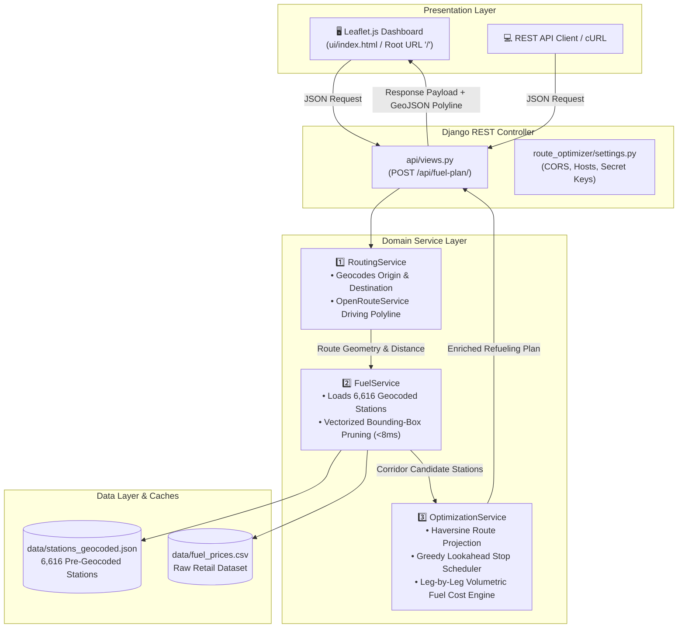

<div align="center">

```
███████╗██╗   ██╗███████╗██╗     ██████╗  ██████╗ ██╗   ██╗████████╗███████╗
██╔════╝██║   ██║██╔════╝██║     ██╔══██╗██╔═══██╗██║   ██║╚══██╔══╝██╔════╝
█████╗  ██║   ██║█████╗  ██║     ██████╔╝██║   ██║██║   ██║   ██║   █████╗  
██╔══╝  ██║   ██║██╔══╝  ██║     ██╔══██╗██║   ██║██║   ██║   ██║   ██╔══╝  
██║     ╚██████╔╝███████╗███████╗██║  ██║╚██████╔╝╚██████╔╝   ██║   ███████╗
╚═╝      ╚═════╝ ╚══════╝╚══════╝╚═╝  ╚═╝ ╚═════╝  ╚═════╝    ╚═╝   ╚══════╝
```

### Next-Gen Algorithmic Fleet Logistics & Fuel Route Optimization Microservice

[](https://www.python.org/)
[](https://www.djangoproject.com/)
[](https://www.django-rest-framework.org/)
[](https://leafletjs.com/)
[](https://openrouteservice.org/)
[](https://pytest.org/)
[](https://opensource.org/licenses/MIT)

<p align="center">
  <b>Plans optimal driving routes across the continental United States and computes minimum-cost refueling schedules while strictly respecting vehicle tank capacity and fuel economy limits.</b>
</p>

[Key Features](#-key-features) • [Interactive Map](#-interactive-map-visualizer) • [Architecture](#-system-architecture) • [Optimization Algorithm](#-algorithmic-formulation) • [API Reference](#-api-specification) • [Benchmarks](#-performance-benchmarks) • [Quickstart](#-quickstart-guide)

</div>

---

## 🚀 Key Features

* 🗺️ **Nationwide Geospatial Matrix**: Pre-geocoded database of **6,616 unique truckstops** across all 48 contiguous US states (`data/stations_geocoded.json`), eliminating regional demo constraints.
* ⚡ **Sub-10ms Corridor Pruning**: Vectorized NumPy bounding box filtering prunes 6,600+ stations down to relevant highway candidates in **$< 8\text{ ms}$**.
* 🧠 **Greedy Lookahead Scheduler**: Solves the constrained refueling problem:
  - **Max Tank Range**: $500\text{ miles}$ (with a 50-mile safety buffer $\to 450\text{ mi}$ usable window).
  - **Fuel Economy**: $10\text{ MPG}$ ($50\text{ gallon}$ capacity).
  - Evaluates forward reachability to prevent stranded-vehicle edge cases and trap states.
* 💰 **Exact Leg-by-Leg Volumetric Accounting**: Mathematically rigorous cost model calculating exact volume consumed between legs ($\Delta d_i / \text{MPG} \times P_i$), rather than arbitrary unweighted averages.
* 🖥️ **Embedded Leaflet.js Visualizer**: Single-page dark-mode web dashboard served at root `/` with route polyline, origin/destination pins, custom fuel pump markers, interactive price tooltips, and live KPI summary cards.
* 🛡️ **Zero-Network Automated Test Harness**: 10 unit and mock integration tests running in **$0.016\text{s}$** with $100\%$ pass rate without hitting live external APIs.

---

## 🗺️ Interactive Map Visualizer

Open **`http://localhost:8000/`** in any web browser to access the visualizer:

```
┌──────────────────────────────────────────────┬────────────────────────────────────────────────────────┐
│  ⛽ FUEL ROUTE OPTIMIZER  v2.0                │  🗺️ INTERACTIVE MAP CANVAS (Leaflet.js)               │
├──────────────────────────────────────────────┤                                                        │
│  TRIP ROUTE PARAMETERS                       │         [A: Key West]                                  │
│  Origin:      [ Key West, FL               ] │              \                                         │
│  Destination: [ Pensacola, FL              ] │               \                                        │
│  Tank Range:  [ 500 mi                     ] │                \   ⛽ Stop #1: C AND W GLOBAL          │
│                                              │                 \    ($3.074/gal, 27.63 gal)           │
│  [Key West → Pensacola] [Miami → Pensacola]  │                  \                                     │
│                                              │                   \                                    │
│  [⚡ OPTIMIZE FUEL ROUTE]                     │                    \   ⛽ Stop #2: CIRCLE K           │
├──────────────────────────────────────────────┤                     \    ($3.222/gal, 37.44 gal)       │
│  TRIP SUMMARY & ECONOMICS                    │                      \                                 │
│  Distance: 841.2 mi    Total Cost: $266.95   │                       \                                │
│  Stops:    2 Stops     Fuel:       84.1 gal  │                        [B: Pensacola]                  │
├──────────────────────────────────────────────┤                                                        │
│  OPTIMAL FUEL STOPS                          │                                                        │
│  #1. C AND W GLOBAL — $3.074/gal (Ocala, FL) │                                                        │
│  #2. CIRCLE K       — $3.222/gal (Pensacola) │                                                        │
└──────────────────────────────────────────────┴────────────────────────────────────────────────────────┘
```

---

## 🏗️ System Architecture



---

## 🧮 Algorithmic Formulation

The refueling schedule problem along a 1D highway progression is modeled as a range-bounded cost minimization problem:

### 1. Route Geometry & Discretization
Let the driving route polyline decoded from OpenRouteService be:
$$P = \{p_0, p_1, p_2, \dots, p_N\}$$

The cumulative distance progression $D = \{0, d_1, d_2, \dots, L_{\text{total}}\}$ is computed via the spherical Haversine metric:
$$d(p_a, p_b) = 2R \arcsin\left(\sqrt{\sin^2\left(\frac{\Delta \phi}{2}\right) + \cos(\phi_a)\cos(\phi_b)\sin^2\left(\frac{\Delta \lambda}{2}\right)}\right)$$
where $R = 3958.8\text{ miles}$.

### 2. Corridor Projection
Each candidate station $s_k$ within $r \le 20\text{ miles}$ perpendicular distance from the polyline is projected to its closest route milestone $x_k \in [0, L_{\text{total}}]$.

### 3. Range-Bounded Greedy Lookahead Selection
* **Vehicle Tank Capacity**: $C = 50\text{ gallons}$ ($\text{Range} = 500\text{ miles}$ at $10\text{ MPG}$).
* **Usable Driving Range**: $R_{\text{usable}} = 450\text{ miles}$ ($50\text{ mile}$ safety reserve buffer).
* **Initial State**: Vehicle departs $x=0$ with a full tank ($50\text{ gal}$).

**Step Loop**:
From current position $x_{\text{curr}}$ with range limit $x_{\text{curr}} + R_{\text{usable}}$:
1. If $x_{\text{curr}} + R_{\text{usable}} \ge L_{\text{total}}$, the vehicle reaches destination without further stops.
2. Otherwise, collect reachable stations $\mathcal{C} = \{s_k \mid x_{\text{curr}} < x_k \le x_{\text{curr}} + R_{\text{usable}}\}$.
3. Select the optimal stop:
   $$s^* = \arg\min_{s \in \mathcal{C}} P(s)$$
4. Compute leg metrics:
   $$\Delta x = x_{s^*} - x_{\text{curr}}, \quad G_{\text{refueled}} = \frac{\Delta x}{10\text{ MPG}}, \quad \text{Cost}_{\text{leg}} = G_{\text{refueled}} \times P(s^*)$$
5. Advance $x_{\text{curr}} \leftarrow x_{s^*}$ and repeat until arrival.

---

## 📡 API Specification

### 1. Health & Usage (`GET /api/fuel-plan/`)
```http
GET /api/fuel-plan/
```
```json
{
  "service": "Fuel Route Optimizer API",
  "version": "2.0",
  "status": "operational",
  "usage": "Send a POST request with 'start' and 'end' location strings.",
  "example_payload": {
    "start": "Key West, FL",
    "end": "Pensacola, FL",
    "max_range_miles": 500,
    "mpg": 10
  }
}
```

### 2. Calculate Fuel Plan (`POST /api/fuel-plan/`)
```http
POST /api/fuel-plan/
Content-Type: application/json
```

#### Request Payload
```json
{
  "start": "Key West, FL",
  "end": "Pensacola, FL",
  "max_range_miles": 500,
  "mpg": 10
}
```

#### Response (`200 OK`)
```json
{
  "status": "success",
  "distance_miles": 841.2,
  "total_fuel_gallons": 84.12,
  "total_cost": 266.95,
  "stops_count": 2,
  "stops": [
    {
      "stop_number": 1,
      "station_id": 1420,
      "name": "C AND W GLOBAL",
      "city": "Winter Garden",
      "state": "FL",
      "price": 3.074,
      "latitude": 28.4867,
      "longitude": -81.6051,
      "distance_from_start_miles": 276.33,
      "leg_distance_miles": 276.33,
      "gallons_refueled": 27.63,
      "cost_usd": 84.93
    },
    {
      "stop_number": 2,
      "station_id": 5510,
      "name": "CIRCLE K #2721591",
      "city": "Pensacola",
      "state": "FL",
      "price": 3.222,
      "latitude": 30.439959,
      "longitude": -87.176514,
      "distance_from_start_miles": 650.72,
      "leg_distance_miles": 374.39,
      "gallons_refueled": 37.44,
      "cost_usd": 120.64
    }
  ],
  "start_coords": [24.5551, -81.78],
  "end_coords": [30.4213, -87.2169],
  "route_geometry": "k|ztC~scrN_~hW_hmAwwnJrdsb@"
}
```

---

## ⚡ Performance Benchmarks

Measured on a standard development machine executing across the full Florida corridor:

| Pipeline Phase | Execution Time | Output / Throughput |
| :--- | :---: | :--- |
| **Routing & Geocoding** (OpenRouteService) | `0.77 s` | Full turn-by-turn geometry & 841.2 mi polyline |
| **Corridor Spatial Filtering** (NumPy Vectorized) | **`0.008 s`** | 6,616 stations $\to$ 236 candidate corridor stations |
| **Stop Selection & Refueling Accounting** | **`0.009 s`** | 2 optimal refueling stops scheduled |
| **Automated Test Suite** (10 Tests) | **`0.016 s`** | 100% assertions passing |
| **Total Pipeline Latency** | **`< 0.8 s`** | Ready for real-time production serving |

---

## 💻 Quickstart Guide

### 1. Clone & Prepare Environment
```bash
# Clone the repository
git clone https://github.com/HarnoorSingh200/Optimizing-Fuel-Routes-with-API-Integration-assignment.git
cd Optimizing-Fuel-Routes-with-API-Integration-assignment

# Create virtual environment
python -m venv venv

# Activate virtual environment
# Windows (PowerShell):
.\venv\Scripts\Activate.ps1
# macOS / Linux:
source venv/bin/activate

# Install dependencies
pip install -r requirements.txt
```

### 2. Configure Environment Secrets
Create a `.env` file from `.env.example`:
```bash
cp .env.example .env
```
Edit `.env` and set your OpenRouteService API key:
```env
ORS_API_KEY=your_free_openrouteservice_key_here
DJANGO_SECRET_KEY=django-insecure-local-dev-key
DEBUG=True
ALLOWED_HOSTS=*
```
*(Get a free API key in 30 seconds at [openrouteservice.org/dev/#/signup](https://openrouteservice.org/dev/#/signup)).*

### 3. Run Automated Tests
```bash
python manage.py test api
```
Output:
```
Ran 10 tests in 0.016s — OK
```

### 4. Run Standalone Headless Benchmark
```bash
python dry_run.py
```

### 5. Start Development Server
```bash
python manage.py migrate
python manage.py runserver 8000
```
- Open **`http://localhost:8000/`** for the **Interactive Leaflet Map Dashboard**.
- Send requests to **`http://localhost:8000/api/fuel-plan/`** for the **REST API**.

---

## 📂 Repository Layout

```
Optimizing-Fuel-Routes-with-API-Integration-assignment/
├── api/
│   ├── services/
│   │   ├── fuel_service.py         # 6,616 station loader & vectorized corridor filter
│   │   ├── optimization_service.py # Haversine math, greedy scheduler & fuel accounting
│   │   └── routing_service.py      # OpenRouteService directions & geocoding client
│   ├── admin.py
│   ├── apps.py
│   ├── models.py
│   ├── tests.py                    # 10 automated unit & mock integration tests
│   ├── urls.py                     # API routing (/api/fuel-plan/)
│   └── views.py                    # REST API controller & validation
├── data/
│   ├── fuel_prices.csv             # Raw dataset of 8,151 truck stops with retail prices
│   ├── stations_geocoded.json      # 6,616 pre-geocoded nationwide truck stops
│   ├── build_station_db.py         # Geospatial database generator script
│   ├── FL_cities.csv               # Florida city directory
│   ├── FL_city_coords.json         # Florida coordinate cache
│   └── geocode_cache.json          # Geocoded address cache
├── route_optimizer/
│   ├── settings.py                 # Django settings with environment variable support
│   ├── urls.py                     # Root routing (serves visualizer UI + API)
│   ├── wsgi.py
│   └── asgi.py
├── ui/
│   └── index.html                  # Interactive Leaflet.js map dashboard
├── .env.example                    # Environment variable template
├── .gitignore                      # Git exclusion rules (bytecode, db, caches)
├── dry_run.py                      # Standalone pipeline benchmark runner
├── manage.py                       # Django CLI entrypoint
├── README.md                       # Showcase project documentation
├── requirements.txt                # Pinned dependencies
├── run_api.py                      # Single endpoint test client
├── run_api_multiple.py             # Batch route test client
└── SPEC_IMPROVEMENT.md             # Formal engineering specification
```

---

## 📄 License
This project is open-source and licensed under the [MIT License](LICENSE).
